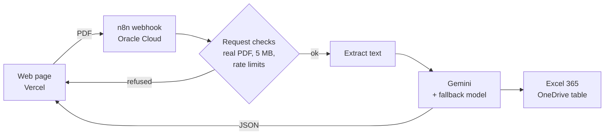

# Saisie Zéro

**Invoices and quotes, entered all by themselves.** · [Version française plus bas](#français)

**Live demo: [saisie-zero.vercel.app](https://saisie-zero.vercel.app)**

Saisie Zéro is a public demo of document automation for small businesses. A visitor drops an invoice or a quote (PDF). An AI model recognises the document type, extracts the useful fields, shows the result on screen and appends a row to a public, read-only Excel workbook. No manual data entry.

## What it does

1. **Upload**: drag and drop a PDF, or pick one of five sample documents (fictitious Belgian companies, 21 % VAT, made-up VAT numbers).
2. **Read**: n8n checks the file, extracts its text and sends it to Google Gemini with a strict JSON schema.
3. **Extract**: supplier and client (name, VAT number), number, date, due date or validity date, line items (description, quantity, unit price, VAT rate), totals excl. VAT, VAT amount, total incl. VAT.
4. **Store**: the result is shown on the page and a row is added to an Excel 365 table on OneDrive. Excel formulas then check the VAT (excl. VAT + VAT = incl. VAT), compute the days left before the due date and set a status (to pay, overdue, valid, expired). A dashboard sheet sums everything up.

| Excel table | Excel dashboard |
|---|---|
|  |  |

## Architecture

| Part | Tool | Notes |
|---|---|---|
| Web page | HTML, CSS, JavaScript (no framework) | Hosted on Vercel. Light and dark themes, mobile layout, reduced-motion support. |
| Automation | n8n 2.x (Community edition) | Docker Compose on an Oracle Cloud "Always Free" ARM server, with PostgreSQL and Caddy (automatic HTTPS). |
| AI | Google Gemini (free tier) | Structured output parser, automatic retries, fallback model when the main one is overloaded. |
| Spreadsheet | Microsoft Excel 365 on OneDrive | Connected through a **Microsoft Entra ID app registration** (Azure), delegated permissions `Files.ReadWrite` and `offline_access` only. |

Everything runs on free tiers.

## Robustness

- The webhook only accepts real PDFs (checks the `%PDF` signature, not the extension), up to 5 MB.
- Rate limits: 10 analyses per hour per visitor, 100 per day for the whole demo, to protect the free Gemini quota.
- Clear error messages for unreadable PDFs, scanned PDFs without text and AI errors.
- CORS restricted to the public page.
- AI output is always rendered as text, never as HTML, so a crafted PDF cannot inject code into the page.

## Repository layout

| Folder | Content |
|---|---|
| `site/` | The public web page. |
| `n8n/` | Workflow export without any key (`saisie-zero-workflow.json`), request-check code and workflow snippets. |
| `excel/` | The Excel workbook and the Python script (openpyxl) that builds it. |
| `exemples/` | The five fictitious sample documents (PDF) and their HTML sources. |
| `deploiement/` | Server setup notes (Docker Compose for n8n, PostgreSQL and Caddy). |
| `docs/` | Screenshots used in this README. |

## Run it yourself

1. Import `n8n/saisie-zero-workflow.json` into n8n (menu "Import from File").
2. Create your own credentials: a Google Gemini API key, and a "Microsoft Excel OAuth2 API" credential backed by your own Entra ID app registration (redirect URI: `https://<your-n8n>/rest/oauth2-credential/callback`).
3. Upload `excel/saisie-zero-documents.xlsx` to your OneDrive and select it in the "Ajouter dans Excel" node.
4. Set the allowed origin of the Webhook node to your page address, then publish the workflow.
5. In `site/config.js`, set `webhookUrl` to your production webhook and `sheetUrl` to a view-only link of your workbook, then deploy `site/`.

## Notes

- All documents, companies, people and VAT numbers are fictitious. Do not upload real documents to the demo.
- Since 1 January 2026, structured e-invoicing (Peppol) is mandatory between Belgian companies. PDF extraction remains useful for quotes, foreign suppliers, expense receipts and PDFs still received by email.
- The Excel step can be swapped for Google Sheets (already in the workflow, disabled) or an accounting tool such as Odoo or Exact Online.

---

## Français

**Vos factures et devis, saisis tout seuls.**

**Démo en ligne : [saisie-zero.vercel.app](https://saisie-zero.vercel.app)**

Saisie Zéro est une démo publique d'automatisation de documents pour PME. Un visiteur dépose une facture ou un devis en PDF. L'IA reconnaît le type de document, en extrait les informations utiles, affiche le résultat à l'écran et ajoute une ligne dans un classeur Excel public, consultable en lecture seule. Aucune saisie à la main.

### Ce que fait la démo

1. **Dépôt** : glisser-déposer d'un PDF, ou choix d'un des cinq documents d'exemple (entreprises belges fictives, TVA 21 %, numéros de TVA inventés).
2. **Lecture** : n8n vérifie le fichier, en extrait le texte et l'envoie à Google Gemini avec un format de réponse JSON imposé.
3. **Extraction** : émetteur et client (nom, numéro de TVA), numéro, date, échéance ou date de validité, lignes (désignation, quantité, prix unitaire, taux de TVA), total HTVA, montant de TVA, total TVAC.
4. **Rangement** : le résultat s'affiche sur la page et une ligne est ajoutée dans un tableau Excel 365 sur OneDrive. Des formules Excel contrôlent la TVA (HTVA + TVA = TVAC), calculent les jours avant l'échéance et donnent un statut (à payer, en retard, valable, expiré). Une feuille « Tableau de bord » fait la synthèse.

### Architecture

| Partie | Outil | Détails |
|---|---|---|
| Page web | HTML, CSS, JavaScript sans bibliothèque | Hébergée sur Vercel. Thèmes clair et sombre, version téléphone, respect du réglage « moins d'animations ». |
| Automatisation | n8n 2.x (édition Community) | Docker Compose sur un serveur ARM Oracle Cloud « Always Free », avec PostgreSQL et Caddy (HTTPS automatique). |
| IA | Google Gemini (version gratuite) | Format de sortie structuré, nouvelles tentatives automatiques, modèle de secours quand le principal est saturé. |
| Tableur | Microsoft Excel 365 sur OneDrive | Relié par une **inscription d'application Microsoft Entra ID** (Azure), avec seulement les autorisations déléguées `Files.ReadWrite` et `offline_access`. |

Tout fonctionne avec des offres gratuites.

### Robustesse

- Le webhook n'accepte que de vrais PDF (signature `%PDF` vérifiée, pas seulement l'extension), de 5 Mo maximum.
- Limites : 10 analyses par heure et par visiteur, 100 par jour pour toute la démo, pour protéger le quota gratuit de Gemini.
- Messages d'erreur clairs pour un PDF illisible, un PDF scanné sans texte ou une erreur de l'IA.
- CORS limité à la page publique.
- Le texte renvoyé par l'IA est toujours affiché comme du texte, jamais comme du HTML : un PDF piégé ne peut pas injecter de code dans la page.

### Organisation du dépôt

| Dossier | Contenu |
|---|---|
| `site/` | La page publique. |
| `n8n/` | Export du workflow sans aucune clé (`saisie-zero-workflow.json`), code de vérification des demandes et morceaux de workflow. |
| `excel/` | Le classeur Excel et le script Python (openpyxl) qui le fabrique. |
| `exemples/` | Les cinq documents d'exemple fictifs (PDF) et leurs sources HTML. |
| `deploiement/` | Notes d'installation du serveur (Docker Compose pour n8n, PostgreSQL et Caddy). |
| `docs/` | Captures d'écran de ce README. |

### Le refaire chez soi

1. Importer `n8n/saisie-zero-workflow.json` dans n8n (menu « Import from File »).
2. Créer ses propres identifiants : une clé d'API Google Gemini, et un identifiant « Microsoft Excel OAuth2 API » basé sur sa propre inscription d'application Entra ID (URI de redirection : `https://<votre-n8n>/rest/oauth2-credential/callback`).
3. Déposer `excel/saisie-zero-documents.xlsx` sur son OneDrive et le choisir dans le bloc « Ajouter dans Excel ».
4. Indiquer l'adresse de sa page dans l'origine autorisée du bloc Webhook, puis publier le workflow.
5. Dans `site/config.js`, mettre l'adresse de production du webhook dans `webhookUrl` et un lien en lecture seule du classeur dans `sheetUrl`, puis déployer `site/`.

### À savoir

- Tous les documents, entreprises, personnes et numéros de TVA sont fictifs. N'envoyez jamais de vrais documents sur la démo.
- Depuis le 1er janvier 2026, la facture électronique structurée (Peppol) est obligatoire entre entreprises belges. L'extraction de PDF reste utile pour les devis, les fournisseurs étrangers, les notes de frais et les PDF encore reçus par e-mail.
- L'étape Excel peut être remplacée par Google Sheets (déjà présent dans le workflow, désactivé) ou par un logiciel comptable comme Odoo ou Exact Online.
