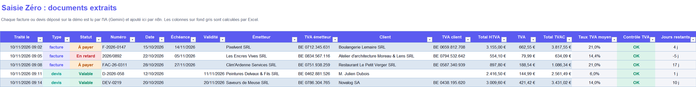
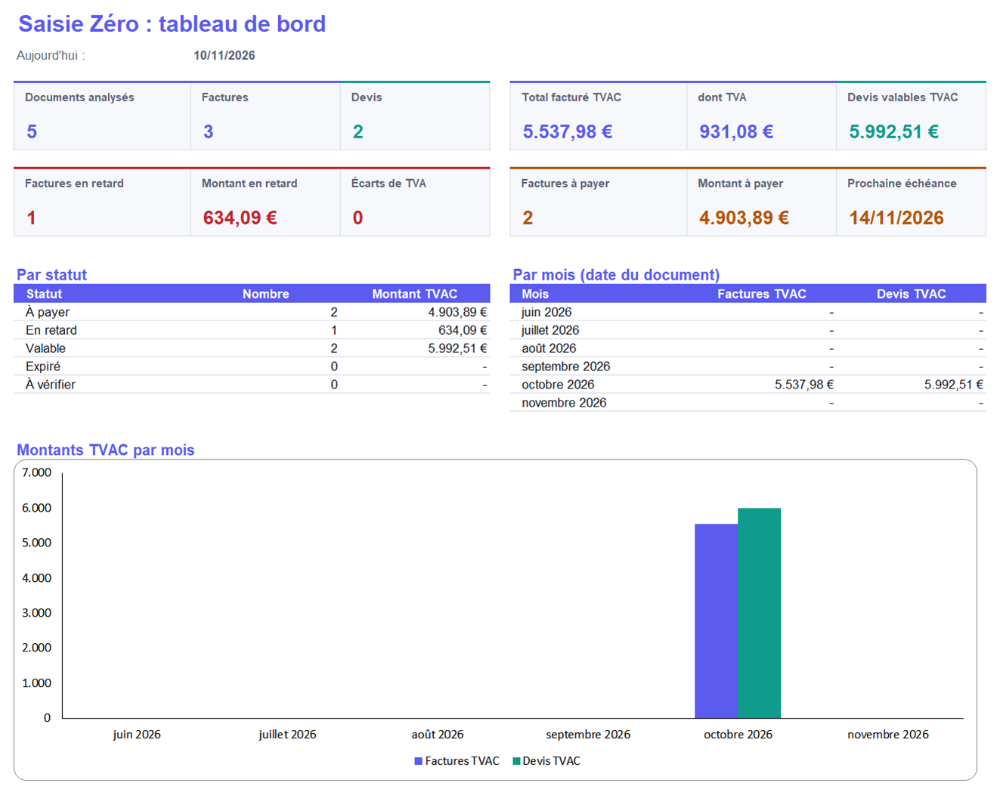
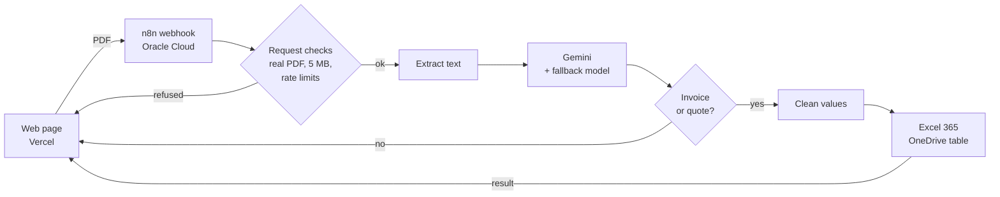
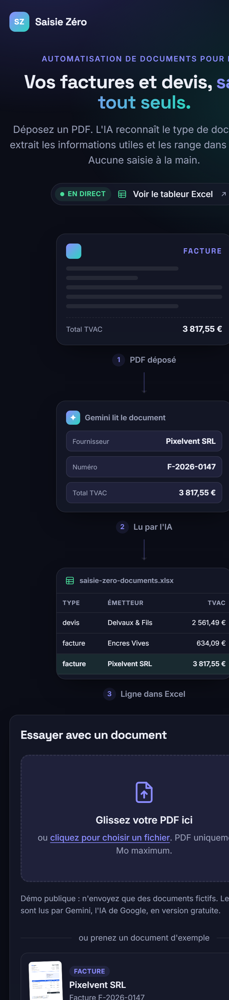

# Saisie Zéro

**Invoices and quotes, entered all by themselves.** · [Version française plus bas](#français)

**Live demo: [saisie-zero.vercel.app](https://saisie-zero.vercel.app)** · Built by Nicolas Carminati

Saisie Zéro is a public demo of document automation for small businesses. A visitor drops an invoice or a quote (PDF). An AI model recognises the document type, extracts the useful fields, shows the result on screen and appends a row to a public, read-only Excel workbook. No manual data entry.

## What it does

1. **Upload**: drag and drop a PDF, or pick one of five sample documents. They are fictitious Belgian companies with made-up VAT numbers, and they include the usual difficulties: 21 %, 12 % and 6 % VAT rates, several rates on one document, a quote titled "Offre de prix", fractional quantities.
2. **Read**: n8n checks the file and extracts its text. Only the text is sent to Google Gemini, with instructions and a JSON schema. The answer is checked against the schema (n8n Structured Output Parser) and retried if it does not match.
3. **Extract**: supplier and client (name, VAT number), number, date, due date or validity date, line items (description, quantity, unit price, VAT rate), totals excl. VAT, VAT amount, total incl. VAT.
4. **Store**: only invoices and quotes are written to the workbook. The values are cleaned first (see [Robustness](#robustness)). Excel formulas then check the VAT (excl. VAT + VAT = incl. VAT), compute the days left before the due date and set a status: to pay, overdue, valid, expired, or "to check" when a date or the type is missing. A dashboard sheet sums everything up.
5. **Answer**: n8n replies to the page after the Excel step, so the page shows what really happened: row added, workbook unavailable, or document not recognised (nothing written).

| Excel table | Excel dashboard |
|---|---|
|  |  |

## Architecture

| Part | Tool | Notes |
|---|---|---|
| Web page | HTML, CSS, JavaScript (no framework) | Hosted on Vercel. Light and dark themes, mobile layout, keyboard access, reduced-motion support. |
| Automation | n8n 2.x (Community edition) | Docker Compose on an Oracle Cloud "Always Free" ARM server, with PostgreSQL and Caddy (automatic HTTPS). Only the webhook address is open to the internet; the n8n editor is reached through an SSH tunnel. |
| AI | Google Gemini (free tier) | Main model `gemini-3-flash-preview`, fallback `gemini-3.8-flash` when the main one returns an error, automatic retries, temperature 0. |
| Spreadsheet | Microsoft Excel 365 on OneDrive | Connected through a **Microsoft Entra ID app registration** (Azure), delegated permissions `Files.ReadWrite` and `offline_access` only. |

Everything runs on free tiers.

## Measured accuracy

The five sample documents were sent to the live demo on 10 November 2026 and every extracted field was compared with the exact values of the documents (script: `evaluation/evaluer.py`, raw answers in `evaluation/`).

| Document | Difficulty | Exact fields |
|---|---|---|
| Invoice Pixelvent | 21 % VAT, standard layout | 24 / 24 |
| Invoice Les Encres Vives | 6 % and 21 % on the same invoice, VAT summary table | 27 / 27 |
| Invoice Clim'Ardenne | quantity 2.5, labels "Date d'émission", "Total à payer" | 24 / 24 |
| Quote Delvaux | 6 % renovation VAT, client without VAT number | 24 / 24 |
| Quote Saveurs de Meuse | titled "Offre de prix", 12 % and 21 % | 24 / 24 |
| **Total** | | **123 / 123** |

Fields compared: type, supplier and client (name and VAT number), number, dates, totals, and quantity, unit price and VAT rate of every line. Line descriptions were not compared. Five documents that I designed myself are not a general accuracy figure: they show that the pipeline works on the cases it was built for.

## Robustness

- **Request checks**: only real PDFs (the `%PDF` signature is checked, not the extension), up to 5 MB. Refusals use standard HTTP codes: 400 (no file), 413 (too large), 415 (not a PDF), 429 (limit reached).
- **Rate limits**: 10 analyses per hour per visitor (reset at the start of each clock hour), 100 per day for the whole demo, to protect the free Gemini quota.
- **Clean data in the public workbook**: only invoices and quotes are written. Before writing, n8n removes leading `=`, `+`, `-` and `@` characters (so that no text can become an Excel formula), shortens long texts, keeps dates only in the `YYYY-MM-DD` format and amounts only if they are numbers, and replaces the uploaded file name with "Document déposé" (except for the samples), because a file name can contain personal data. Tested with a fake invoice whose client was `=1+1` and whose line was `=HYPERLINK(...)`: both were written as plain text.
- **Clear messages** for unreadable PDFs, scanned PDFs without text, AI errors, and an unavailable workbook.
- **Page safety**: AI output is always rendered as text, never as HTML, so a crafted PDF cannot inject code into the page.
- **CORS** is limited to the public page. It only stops other websites from calling the demo from a browser; scripts are limited by the rate limits.

## Limits

- Scanned PDFs (images without text) are refused: only the extracted text is sent to the AI.
- No human validation step: in a real company, rows flagged by the VAT check or the "to check" status would go to a person.
- The free Gemini tier is sometimes slow: usually 10 to 30 seconds, but one answer took 3 minutes during the evaluation. The fallback model only starts when the main one returns an error, not when it is slow. The page waits up to 4 minutes.
- Statuses and days left depend on today's date: over time, the October 2026 samples naturally become "overdue" or "expired".
- The rate limit counter is simple (clock hour, stored by n8n): two requests sent at exactly the same time can both pass.

## Repository layout

| Folder | Content |
|---|---|
| `site/` | The public web page. |
| `n8n/` | Workflow export without any key (`saisie-zero-workflow.json`) and the code of the two Code nodes. |
| `excel/` | The Excel workbook and the Python script (openpyxl) that builds it. |
| `exemples/` | The five fictitious sample documents (PDF) and their HTML sources. |
| `evaluation/` | Accuracy test: raw answers of the demo and comparison script. |
| `deploiement/` | Server setup (Docker Compose for n8n, PostgreSQL and Caddy). |
| `docs/` | Screenshots used in this README. |

## Run it yourself

1. Import `n8n/saisie-zero-workflow.json` into n8n (menu "Import from File").
2. Create your own credentials: a Google Gemini API key, and a "Microsoft Excel OAuth2 API" credential backed by your own Entra ID app registration (redirect URI: `https://<your-n8n>/rest/oauth2-credential/callback`).
3. Upload `excel/saisie-zero-documents.xlsx` to your OneDrive and select it in the "Ajouter dans Excel" node.
4. Set the allowed origin of the Webhook node to your page address, then publish the workflow.
5. In `site/config.js`, set `webhookUrl` to your production webhook and `sheetUrl` to a view-only link of your workbook, then deploy `site/`.

## Notes

- All documents, companies, people and VAT numbers are fictitious. Do not upload real documents to the demo.
- Since 1 January 2026, structured e-invoicing (Peppol) is mandatory between Belgian companies. PDF extraction remains useful for quotes, foreign suppliers, expense receipts and PDFs still received by email.
- The Excel step can be swapped for Google Sheets or an accounting tool such as Odoo or Exact Online.
- License: MIT (see `LICENSE`).

---

## Français

**Vos factures et devis, saisis tout seuls.**

**Démo en ligne : [saisie-zero.vercel.app](https://saisie-zero.vercel.app)** · Réalisé par Nicolas Carminati

Saisie Zéro est une démo publique d'automatisation de documents pour PME. Un visiteur dépose une facture ou un devis en PDF. L'IA reconnaît le type de document, en extrait les informations utiles, affiche le résultat à l'écran et ajoute une ligne dans un classeur Excel public, consultable en lecture seule. Aucune saisie à la main.

### Ce que fait la démo

1. **Dépôt** : glisser-déposer d'un PDF, ou choix d'un des cinq documents d'exemple. Ce sont des entreprises belges fictives, avec des numéros de TVA inventés, et ils contiennent les difficultés habituelles : TVA à 21 %, 12 % et 6 %, plusieurs taux sur un même document, un devis intitulé « Offre de prix », des quantités à virgule.
2. **Lecture** : n8n vérifie le fichier et en extrait le texte. Seul le texte est envoyé à Google Gemini, avec des consignes et un schéma JSON. La réponse est vérifiée par rapport à ce schéma (Structured Output Parser de n8n), avec une nouvelle tentative si elle n'est pas conforme.
3. **Extraction** : émetteur et client (nom, numéro de TVA), numéro, date, échéance ou date de validité, lignes (désignation, quantité, prix unitaire, taux de TVA), total HTVA, montant de TVA, total TVAC.
4. **Rangement** : seuls les factures et les devis sont écrits dans le classeur, après nettoyage des valeurs (voir [Robustesse](#robustesse)). Des formules Excel contrôlent la TVA (HTVA + TVA = TVAC), calculent les jours avant l'échéance et donnent un statut : à payer, en retard, valable, expiré, ou « à vérifier » quand une date ou le type manque. Une feuille « Tableau de bord » fait la synthèse.
5. **Réponse** : n8n répond à la page après l'étape Excel. La page affiche donc ce qui s'est vraiment passé : ligne ajoutée, classeur indisponible, ou document non reconnu (rien d'écrit).

### Architecture

| Partie | Outil | Détails |
|---|---|---|
| Page web | HTML, CSS, JavaScript sans bibliothèque | Hébergée sur Vercel. Thèmes clair et sombre, version téléphone, accès au clavier, respect du réglage « moins d'animations ». |
| Automatisation | n8n 2.x (édition Community) | Docker Compose sur un serveur ARM Oracle Cloud « Always Free », avec PostgreSQL et Caddy (HTTPS automatique). Seule l'adresse du webhook est ouverte sur Internet ; l'éditeur n8n s'ouvre par un tunnel SSH. |
| IA | Google Gemini (version gratuite) | Modèle principal `gemini-3-flash-preview`, secours `gemini-3.8-flash` quand le principal renvoie une erreur, nouvelles tentatives automatiques, température 0. |
| Tableur | Microsoft Excel 365 sur OneDrive | Relié par une **inscription d'application Microsoft Entra ID** (Azure), avec seulement les autorisations déléguées `Files.ReadWrite` et `offline_access`. |

Tout fonctionne avec des offres gratuites.

### Fiabilité mesurée

Les cinq documents d'exemple ont été envoyés à la démo en ligne le 10 novembre 2026, et chaque champ extrait a été comparé aux valeurs exactes des documents (script `evaluation/evaluer.py`, réponses brutes dans `evaluation/`).

| Document | Difficulté | Champs exacts |
|---|---|---|
| Facture Pixelvent | TVA 21 %, mise en page classique | 24 / 24 |
| Facture Les Encres Vives | 6 % et 21 % sur la même facture, récapitulatif de TVA | 27 / 27 |
| Facture Clim'Ardenne | quantité 2,5, libellés « Date d'émission », « Total à payer » | 24 / 24 |
| Devis Delvaux | TVA rénovation 6 %, client sans numéro de TVA | 24 / 24 |
| Devis Saveurs de Meuse | intitulé « Offre de prix », 12 % et 21 % | 24 / 24 |
| **Total** | | **123 / 123** |

Champs comparés : type, émetteur et client (nom et numéro de TVA), numéro, dates, totaux, ainsi que la quantité, le prix unitaire et le taux de TVA de chaque ligne. Les désignations n'ont pas été comparées. Cinq documents que j'ai conçus moi-même ne donnent pas une fiabilité générale : ils montrent que la chaîne fonctionne sur les cas prévus.

### Robustesse

- **Contrôle des demandes** : seulement de vrais PDF (signature `%PDF` vérifiée, pas seulement l'extension), de 5 Mo maximum. Les refus utilisent les codes HTTP standard : 400 (aucun fichier), 413 (trop lourd), 415 (pas un PDF), 429 (limite atteinte).
- **Limites** : 10 analyses par heure et par visiteur (remise à zéro au début de chaque heure), 100 par jour pour toute la démo, pour protéger le quota gratuit de Gemini.
- **Données propres dans le classeur public** : seuls les factures et les devis sont écrits. Avant l'écriture, n8n retire les caractères `=`, `+`, `-` et `@` en début de texte (pour qu'aucun texte ne devienne une formule Excel), raccourcit les textes longs, ne garde que les dates au format `AAAA-MM-JJ` et les montants qui sont des nombres, et remplace le nom du fichier déposé par « Document déposé » (sauf pour les exemples), car un nom de fichier peut contenir des données personnelles. Testé avec une fausse facture dont le client était `=1+1` et une ligne `=HYPERLINK(...)` : les deux ont été écrits comme du texte simple.
- **Messages clairs** pour un PDF illisible, un PDF scanné sans texte, une erreur de l'IA et un classeur indisponible.
- **Sécurité de la page** : le texte renvoyé par l'IA est toujours affiché comme du texte, jamais comme du HTML : un PDF piégé ne peut pas injecter de code dans la page.
- **CORS** limité à la page publique. Il empêche seulement d'autres sites d'utiliser la démo depuis un navigateur ; les scripts sont freinés par les limites d'analyses.

### Limites

- Les PDF scannés (images sans texte) sont refusés : seul le texte extrait est envoyé à l'IA.
- Pas d'étape de validation humaine : dans une vraie entreprise, les lignes signalées par le contrôle de TVA ou par le statut « à vérifier » iraient à une personne.
- La version gratuite de Gemini est parfois lente : en général 10 à 30 secondes, mais une réponse a pris 3 minutes pendant l'évaluation. Le modèle de secours ne prend le relais qu'en cas d'erreur, pas de lenteur. La page attend jusqu'à 4 minutes.
- Les statuts et les jours restants dépendent de la date du jour : avec le temps, les exemples d'octobre 2026 passent normalement en « en retard » ou « expiré ».
- Le compteur de limites est simple (heure d'horloge, gardé par n8n) : deux demandes envoyées exactement au même moment peuvent passer toutes les deux.

### Organisation du dépôt

| Dossier | Contenu |
|---|---|
| `site/` | La page publique. |
| `n8n/` | Export du workflow sans aucune clé (`saisie-zero-workflow.json`) et code des deux blocs Code. |
| `excel/` | Le classeur Excel et le script Python (openpyxl) qui le fabrique. |
| `exemples/` | Les cinq documents d'exemple fictifs (PDF) et leurs sources HTML. |
| `evaluation/` | Test de fiabilité : réponses brutes de la démo et script de comparaison. |
| `deploiement/` | Installation du serveur (Docker Compose pour n8n, PostgreSQL et Caddy). |
| `docs/` | Captures d'écran de ce README. |

### Le refaire chez soi

1. Importer `n8n/saisie-zero-workflow.json` dans n8n (menu « Import from File »).
2. Créer ses propres identifiants : une clé d'API Google Gemini, et un identifiant « Microsoft Excel OAuth2 API » basé sur sa propre inscription d'application Entra ID (URI de redirection : `https://<votre-n8n>/rest/oauth2-credential/callback`).
3. Déposer `excel/saisie-zero-documents.xlsx` sur son OneDrive et le choisir dans le bloc « Ajouter dans Excel ».
4. Indiquer l'adresse de sa page dans l'origine autorisée du bloc Webhook, puis publier le workflow.
5. Dans `site/config.js`, mettre l'adresse de production du webhook dans `webhookUrl` et un lien en lecture seule du classeur dans `sheetUrl`, puis déployer `site/`.

### À savoir

- Tous les documents, entreprises, personnes et numéros de TVA sont fictifs. N'envoyez jamais de vrais documents sur la démo.
- Depuis le 1er janvier 2026, la facture électronique structurée (Peppol) est obligatoire entre entreprises belges. L'extraction de PDF reste utile pour les devis, les fournisseurs étrangers, les notes de frais et les PDF encore reçus par e-mail.
- L'étape Excel peut être remplacée par Google Sheets ou par un logiciel comptable comme Odoo ou Exact Online.
- Licence : MIT (voir `LICENSE`).
